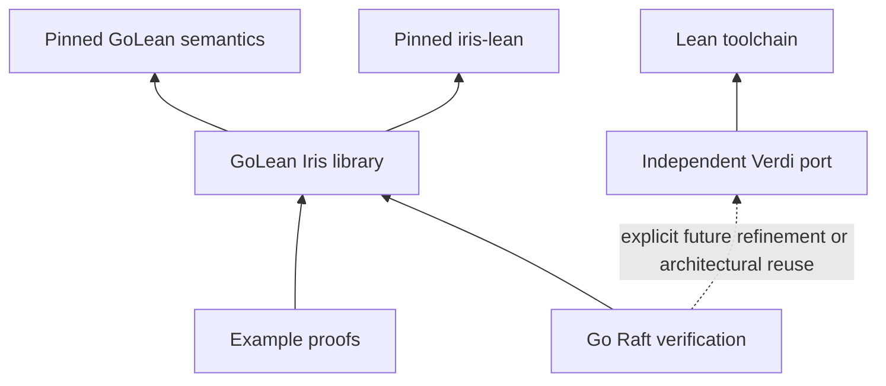

# Reasoning experiments: source survey and proposed revival structure

[AGENT] survey, 2026-09-16. Requested by [USER] in this session: inspect the
reasoning experiments without disturbing other agents, assess what survives,
and propose an understandable structure for a future repository, including
an independent home for the Verdi port. The structure and priorities below
are proposals, not adopted architecture or authorization to migrate.

[USER] follow-up, same session: the next task will assemble one or more
new repositories inside a gitignored directory such as `deps/`. The three
projects to distinguish are the etcd-io/raft proof, Verdi port and reasoning
system; whether they share a repository remains open. This survey proposes
both the logical boundaries and a hosting choice below. It does not perform
that next task.

[USER] stopping point, same session: “pause before doing the assembly so
we can discuss the plan.” Repository creation and assembly therefore wait
for that discussion and a subsequent instruction to proceed.

[USER] subsequent preference, same session: Verdi is probably the easiest
independent revival, but is a component of a future etcd-io/raft proof and
should probably share a repository with that work once suitable reasoning
support exists. The recommendation in §9 incorporates this grouping while
keeping Verdi an independently buildable package. This is a preferred
direction, not approval to start assembly.

The reference main tip is `32398203b20672cb5b5751db58bab2d06b243ea8`.
This document was prepared on `docs/reasoning-archaeology-0916`, in its own
worktree. No existing worktree, stash, dependency checkout, runtime source,
gate or baseline was changed. No branches were merged or pushed.

## 1. Assessment

There is substantial reusable work, but there is no single branch to turn
into the new development main unchanged.

1. **The Verdi safety port is the most self-contained result.** At the
   parked tip, `compat/verdi` is already a separate Lake package, with no
   GoLean or Iris package dependency. It contains native Lean proofs of
   election safety, log matching, leader completeness and state-machine
   safety over the ported abstract Raft model. Linearizability remains a
   statement port. These are not proofs about the Go implementation.
2. **The parked Iris package is a substantial library and historical proof
   corpus.** It contains real Iris lifting, ownership, adequacy, structural
   rules and program proofs, alongside direct machine proofs and older
   enumerative proofs. It depends deeply on an obsolete machine
   representation. Preserve it as a reproducible historical result and
   harvest deliberately; do not describe it as current-core compatible.
3. **The September Iris customer is the best starting point for a current
   core consumer.** The code on surveyed main goes beyond its README: it
   includes reusable call/allocation/unwind rules and a shared-capture
   recovery example proved for both Boolean inputs and every choice tape.
   It is still a narrow sequential experiment, with whole-cell ownership
   and substantial dependence on machine internals.
4. **The Go Raft proof remains an unfinished connection between layers.**
   There are useful abstract invariant chains, concrete program readers,
   quorum proofs and checker-span proofs. The parked `AgreementT1` and
   `CompletionWitness` are definitions of goals, not completed theorems.
   A broad Verdi safety result cannot fill that gap by itself.
5. **Some important artifacts exist only as local working changes or
   stashes.** Most notably, the B7 context/store migration and its updated
   Iris adapter are not represented by the `typed-context-store` branch
   tip alone. A normal clone of the advertised branches would miss them.

The recommended revival separates the Verdi library, current GoLean/Iris
reasoning system and Go Raft proof at package level. The graded example
corpus belongs with the reasoning system. Following the [USER] preference,
§9 recommends two repositories under one ignored workspace: the reasoning
system, and a combined Raft repository containing independent Verdi and
etcd-proof packages. Historical replays and unaccepted experiments stay
outside default builds.

## 2. Scope and evidence standard

This is a **fresh source and Git survey, not a fresh proof certification**.
I inspected manifests, import roots, theorem statements and representative
proof bodies, branch ancestry/differences, audit implementations, recorded
reviews, and worktree status. No Lean build, differential run, comparator
judge, Rocq extraction, dependency installation or network fetch was run.
Statements below that a gate passed describe historical records only.

The inventory observed 521 refs: 252 local branches, 8 remote-tracking refs,
259 `refs/snapshots/*`, one `refs/archive/*`, and `refs/stash`. It enumerated
73 worktrees, including this survey's, and eight stash entries. These are
time-of-inspection counts, not an atomic snapshot of the shared repository.
Remote-tracking refs were read locally; their presence does not certify the
current remote. Ignored build caches and scratch outputs were not exhaustively
audited; no search for unreachable Git objects was performed.

The source census covered tracked Lean paths under `proofs/`, `compat/`
and `spikes/` across local branch tips, with closer inspection of the
families below. Many branches are old checkpoints, not independent projects.
Historical source copies used for inspection stayed in this worktree's
ignored `artifacts/survey/`; they are not part of the deliverable.

**Reading source references.** `park:path` means the file at
`7440bf705a87b052243ff36280b677f4100b6a66`; `main:path` means the main pin
above. Other short pins resolve through §11. Branch-qualified paths refer
to committed source, unless explicitly marked **working tree only**.
For example, without checking out or changing anything:

```sh
git show 7440bf705a87b052243ff36280b677f4100b6a66:compat/verdi/lakefile.toml
git show 7fa0e04d841e12f09120f263634adbbe1368c694:proofs/GoLeanProofs/Specs/Raft/SpanS23.lean
git diff 7440bf705a87b052243ff36280b677f4100b6a66 32398203b20672cb5b5751db58bab2d06b243ea8 -- GoLean/GoCore/State.lean
```

Use full commit IDs or `refs/heads/...` for durable retrieval.
`archive/callspec-era` is ambiguous as a short ref here: both
`refs/heads/archive/callspec-era` and `refs/archive/callspec-era` exist,
currently at the same commit.

## 3. Where the material lives

| Source | What to retrieve | Assessment |
|---|---|---|
| `park/reasoning-2026-08-31` @ `7440bf70` | `proofs/`, `compat/`, proof-era scripts, golden pins and documentation | Canonical last integrated pre-split reasoning tree. Start historical reproduction here. |
| `raft-proof-campaign` @ `17197113` | Especially `docs/raft-campaign-log.md` | Separate coordinator history, including later review and decision records absent from park. Its code tree is not a successor to the parked code. |
| `design-pass` @ `24212862` | `docs/2026-08-27_design-pass-findings.md`, `...clean-proof-plan-v3-DRAFT.md`, corpus-plan drafts | Critical design archaeology. Do not adopt an older draft over the final corpus plan on park. |
| `wp-design` @ `c3dc3986` | `docs/2026-08-16_wp-arc-charter.md`, `...symbolic-domain-design.md` | Six branch-only commits touching those two documents; useful rationale, not a separate newer logic implementation. |
| `campaign-arc4d` @ `7fa0e04d` | `SpanS1*`, `SpanS23*`, `SpanCells`, `UtoaSpan`, `Sym/UtoaForKit`, `Audit/Span*`, lane log | Important unmerged checker-span proofs; historical gate remained red on audit coverage. Harvest with their premises and dependencies. |
| `campaign-ce` @ `a1d70861` | `Frame/SpanIso*`, changes to `ChoiceCanon`/`ChoiceInv`, lane log | Partial heap-isomorphism/canonicalization experiment, not a completed equivalence theorem. |
| `campaign-wave-a` @ `b3c329c8` | Round/lens changes; additional local files in its worktree | Killed trajectory-era continuation. The local total-correctness draft is not on this branch. |
| `archive/fixed-trajectory-era` @ `c4986b29` | The pre-W0 proof tree and generators | Historical archive of a deliberately abandoned proof strategy. Not a migration baseline. |
| `archive/callspec-era` @ `20cda772` | `SpecJudgment`, `Specs/RaftPilot/*`, the defective invariant definition | Historical bespoke calculus; retain lessons and selected specifications, not the parallel calculus. |
| `channel-logic` @ `f49752a6`; `channel-logic-s4` @ `9fbf674d` | Channel resources/protocol examples, `LangDM`, reduction investigations | Separate parked concurrency experiment. S4 has a refuted target; neither tip is current-core ready. |
| Surveyed main @ `32398203` | `spikes/gate-a1`, `spikes/iris-customer` | Current sequential adapters and customer proofs; semantic bridges stay in GoLean. |
| `typed-consumer-sprint` @ `7edc298f` | Full September experiment history and evidence | Archive, superseded for landed components by reviewed main-side chunks. Do not import the whole sprint. |
| `typed-context-store` @ `ca1e01d5` **plus working changes** | Context-indexed Iris adapter, heap-only store migration, correspondence audit | Substantial uncommitted work. Core refactor belongs to GoLean; customer changes are future migration material. |
| `typed-shared-customer` @ `bd31dd5d`; review worktree @ `163d44ea` | Shared-capture customer lineage and independent challenges | Prefer the reviewed landed code for revival; preserve local review additions separately. |
| `typed-byte-store-*`, particularly `68590160` / `631b883f` | `spikes/byte-store` and independent review | Semantics optimization/refinement experiment, not a program logic component. Catalog here; keep its ownership on the core side. |

Additional checkpoints are already represented in this map. `g-bind` is
exactly the parked tip. `u0-iris-refresh`, `quorum-pilot`, `proof-automation`,
`worktree-verdi-compat` and `worktree-gobra-contracts` are ancestors of park;
they are provenance, not more advanced alternatives. `campaign-arc4` equals
the fixed-trajectory archive; `w1-prover` equals the CallSpec archive.
`w3-init` and `w3-m` preserve worker-era variants whose useful substrate and
retirement decisions must be read against park's `docs/ARCHIVE.md`.
The `worktree-agent-*` tips in the inventory are early 40/41-module proof
trees, not later revival candidates.

The path census also found `Laws/QuorumOps.lean` on early quorum branches
and `Examples/WordCount/CountGeneric.lean` on `ci-followup`/`ci-gate-hardening`,
absent from the later inventories. These are historical implementation
alternatives, not evidence of an additional completed verification target.

## 4. The Verdi port: extractable as an independent library

### Source and actual achievement

Use **`park:compat/verdi/`**, not the much earlier
`worktree-verdi-compat` checkpoint. The parked package has 26 library
modules under `VerdiCompat/`, totaling 36,499 source lines. Including the
aggregate, audit, differential driver and six tracked `.scratch/*.lean`
files gives 35 Lean files / 38,972 lines. These are physical source counts,
including comments and blanks, not proof-size or theorem counts.

The library contains the network and handler model (`Net`, `RaftState`,
`Raft`), structural/list helpers, three layers of reachability and ghost
refinement, and the safety invariant network. The important exported
results are directly visible in source:

| Result | Lean source and export | Scope |
|---|---|---|
| Election safety | `ElectionSafety.lean`, `oneLeaderPerTermStatement_holds` | Every `raft_intermediate_reachable` base network satisfies `one_leader_per_term`. |
| Log matching | `LogMatching.lean`, `logMatchingStatement_holds` | Base-network reachability; host and network-message components. |
| Leader completeness | `LeaderCompleteness.lean`, `leader_completeness_invariant` | The refined network carrying election/log ghost information. |
| State-machine safety | `StateMachineSafety.lean`, `stateMachineSafetyStatement_holds` | Base network, after the two ghost-removal transfers. |
| Linearizability | `Linearizability.lean`, `RaftLinearizable.lean` | Definitions/statement vocabulary; no port of the complete linearizability proof. A conclusion witness in `Examples` is not that theorem. |

`Properties.lean` defines the first, second and fourth statement targets;
their proofs take reachability premises, not an assumed safety result.
`RefinedProofStructure`, `MsgRefinement`, `GhostLogs`, `SafetyPrime` and
`MatchIndexAllEntries` are substantial connective infrastructure, not just
stubs around the headline declarations.

Source annotations map definitions and arguments back to pinned Rocq
files. The historical setup records `verdi` `7e1641b`, `verdi-raft`
`a3375e8`, and `StructTact` `97268e1`. The arc-3 design's
closing section describes roughly 80 upstream proof files and an 84-row
invariant index in `park:docs/campaign-arc3-log.md`. Those are historical
accounting figures; the file counts above were re-derived in this survey.

### Independence and validation boundary

`compat/verdi/lakefile.toml` has **no `[[require]]` dependencies**. Its
default targets are `VerdiCompat`, `AxCheck` and `diffharness`; the toolchain
is Lean 4.32.2. No GoLean or Iris import is needed to state or prove its
safety results. Factoring it out is principally a packaging/provenance
task, rather than untangling the Go proof library.

`AxCheck.lean` enforces the smaller axiom set `{propext, Quot.sound}`;
the Go/Iris package uses the classical trio including `Classical.choice`.
Keep these policies separate. Recorded CI builds the port and compares
Lean handler output with `fixtures/handlers-n3.tsv`. The Rocq oracle in
`extraction/` is an **on-demand** extraction/OCaml run requiring the pinned,
built reference theories. Ordinary CI did not rerun it. A fixture-drift
check is consequently not a fresh cross-language comparison.

The older design proposed Rocq-to-Lean certificate transport. Its
**2026-08-11 §9 ruling superseded that with native proof translation**.
Do not report a certified cross-kernel equivalence: the evidence is Lean
proofs about a source-aligned Lean model, finite handler differentials and
review. Some proofs deliberately re-derive an upstream argument rather
than preserve its tactic structure.

### Revival recommendation

Make this a named independent package, initially retaining `VerdiCompat`
namespaces and module paths to avoid simultaneous proof and packaging
changes. Give it its own README, theorem index, source-pin/provenance file,
axiom gate, and separate commands for Lean-only and Rocq-oracle checks.
Do not bring `.scratch/` into the public library or conflate scratch with
audited modules. Preserve licenses and upstream attribution with the source.

Place it in the combined Raft repository as an independently buildable
package. The etcd-proof package can consume or draw on it later, but no
other project should be required to build Verdi. Modernizing its toolchain
should be separate from extracting and reproducing the existing result.

## 5. What the Go Raft campaign actually proved

There are three different subjects that old summaries sometimes compress
into “Raft verification”:

| Subject | Existing material | Missing connection |
|---|---|---|
| The ported Verdi abstract protocol | The safety results above | A proof relating the relevant Go implementation/envelope to this model, if direct theorem reuse is chosen. |
| An etcd-oriented abstract election/history model | `Specs/Raft/NativeObligations`, `NativeS1Chain`, `NativeEtcdDischarge`, `NativeS23Route`, `NativeS23Chain`, witnesses | Derivation of all model obligations from actual interpreter executions. |
| Concrete Go library routines and the n=3 twin harness | Quorum WP proofs, pinned lowerings, state readers, checker folds/spans, old trajectory experiments | A composed invariant and implementation proof covering all intended choices and the complete target contract. |

### The real Go subject and harness remain on main

[`raftsubject/`](../raftsubject/README.md) is the derived etcd-io/raft
subject at recorded upstream pin `56e3200`; its short import paths, plain
protobuf representation and overlays are deliberate subject deltas.
[`raftharness/`](../raftharness/README.md) contains the harness family,
including election, partition and crash/restart exercises. Source derivation
lives under `tools/raftsubject/`; lowering is guarded by
`scripts/check-frontend-pins`. These directories were byte-unchanged between
park and surveyed main (`git diff --name-only` over both was empty),
although the frontend and machine changed considerably.

They remain semantics test subjects under the current charter. The future
proof repository should reference their pinned version and own its proof
artifacts/specifications, rather than silently fork a second Go subject.
The sentence “source the machine verifies” in the subject README is
historical wording, not a present program-verification claim.

### Useful concrete proof assets

- `park:proofs/GoLeanProofs/Specs/GoldenQuorumWP.lean` proves actual lowered
  quorum routines through Iris, including `quorumAckedIndexFuncSpec2`,
  `quorumOneKnownFuncSpec` and result/negative readouts.
  `GoldenQuorumThree`, `GoldenQuorumAll`, `QuorumRefSpec` and
  `QuorumTargets` extend and specify this family;
  `committedIndexAllConfigs` is a useful larger library milestone.
- `Specs/Raft/AbsState`, `AbsStateV2`, `AbsTwinRead`,
  `AbsTwinCheckerRead`, `RenCongr` and `MapPermRead` supply concrete
  projections and transport facts. `DriverNet` ties parts of the harness
  structure to the lowered program. Their concrete layout assumptions
  require rechecking on a new pin.
- `NativeS1Chain` proves election invariance given `ElectObligations`.
  `NativeEtcdDischarge.etcd_discharges` constructs that interface for
  an **abstract election fragment**, not directly for Go `raft.Step`.
  Its `EStep` explicitly requires response genuineness (`hgen`); the
  module explains the separate network correspondence this stands for.
- `NativeS23Chain` proves the history/apply chain for a fixed leader/term
  fragment. Commit certification and apply-window obligations occur as
  constructor premises of `HStep`. The abstract history is not already a
  proof that arbitrary concrete handler calls preserve those premises.
- `NativeCheckerBridge` proves the `s1Step`/`s23Step` fold models silent
  on conforming model traces, and pins their guards in lowered code.
  Its header explicitly leaves interpreter-span correspondence open.

The last gap has more work **off park**: `campaign-arc4d` contains
`s1_span_computes` in `SpanS1Walk.lean` and `s23_span_computes` in
`SpanS23.lean`, plus `s1_abs_step`/`s23_abs_step`, witnesses, map helpers and
`utoa` loop machinery. The log reports symbolic checker-state results,
with S23 restricted to `EntryNormal`. It still names trace/projection and
event-encoding connections needed by final assembly. Its recorded CI
exited 1 on 19 unregistered proof files; compensating per-module/audit
checks are recorded, but this was not an all-green landed branch. Park's
archive index warns that these are harvest material from the retired
proof shape. Recover specifications and reusable arguments before deciding
whether any concrete walk survives the current Iris architecture.

### The unproved target and the retired strategies

`park:proofs/GoLeanProofs/Specs/RaftAgreement.lean` contains:

```text
AgreementT1       : every successful twin run, at any fuel and choices,
                    returns zero violations
CompletionWitness: some fuel and choice stream complete with the
                    completion and exercise-floor fields set
```

Both are `def ... : Prop`; the parked proof tree contains no other use of
either name. They are not a completed agreement theorem or completion
witness. The scope is the n=3, reliable-first, bundled-harvest,
single-election twin, not arbitrary deployments of etcd Raft. Its violation
count also covers harness error/liveness guards, so proving only the three
abstract safety checks would be insufficient even for that scoped target.

The **fixed-trajectory era** built more than a million lines of generated
heap/configuration literals and specialized handler/round equations. W0
deliberately removed that approach. `park:docs/ARCHIVE.md` documents its
kill list, failed heap-splice design, and harvest boundaries. A kernel
proof about a fixed execution can be mathematically valid while being the
wrong claim or an unusable development strategy.

The **CallSpec era** then built a parallel continuation-parametric calculus
over the executable machine (`SpecJudgment.lean`) while Iris already
existed. It was retired in favor of Iris composition. Its leaf readback
specifications and measured loop/call geometry remain useful requirements;
its fixture-addressed judgment corpus should not become a second logic.

`Specs/RaftPilot/Invariant.lean` in that archive is particularly unsuitable
for copying: the W2.5 postmortem records unpreservable
`ElectedAt.logBridge`/`commitTie` clauses and the missing intended
concrete-log/history connection. This was caught at definitions-only
stage, before consumers; it is a design failure, not an unsound Lean
theorem. The repaired invariant design gate remained owed.

The wave-a worktree contains an untracked `RaftTotalCorrectness.lean`
defining a stronger “every tape has some successful fuel and passing
verdict” contract. Its only theorem decomposes an **assumed**
`TotalCorrectness`; it does not establish that assumption. Preserve this
as a proposal. Reassess its progress/fairness assumptions before adoption,
and distinguish bounded harness completion from protocol liveness.

## 6. The two Iris generations

### The parked general library

`park:proofs/` is a separate `golean-proofs` Lake package with 324 Lean
files / 194,861 physical lines. `Examples/` accounts for 132 files /
107,593 lines; `Laws/` has 12 files / 6,503 lines. Size includes program
representations and direct machine proofs as well as Iris proofs; it is
not a measure of reusable Iris automation.

| Layer | Main source | Reuse assessment |
|---|---|---|
| Language, resources, lifting | `Lang`, `HeapBridge`, `Ghost`, `Lifting`, `Inversions` | Real sequential Iris instance and heap interpretation. Port ideas to the current representation; do not install duplicate instances beside the new ones. |
| Construct rules | `Laws/{Control,Init,Eval,Assign,Call,Loop,Range,Values,StmtOps,Unwind,Slice,Bind}` | Good rule inventory and proof patterns. Check operational premises against the new core. |
| Adequacy and statements | `Adequacy`, `Surface`, `SurfaceBridge`, `SurfaceExit`, `TotalWp` | Valuable separation of first-order execution claims from Iris proofs. Whole-program exit coverage was incomplete at park. |
| Composition | `Frame/Plug*`, `Laws/Bind`, `Specs/Callchain*` | Best parked example of structural WP composition. Conditional bind theorem, not an unconditional evaluation-context instance. |
| Data/loop helpers | `SliceMem`, `MapMem`, `StringMem`, `SliceWalk`, `MapLoops`, `MapPerm`, `CondFor`, `StepKit`, `FuelMeasure` | Harvest on demand; separate generic mathematics from machine layout and trajectory machinery. |
| Automation | `Tactics/GoWalk`, `Sym/*`, `Frame/*`, `FastEval/*` | Mixed roles: WP automation, executable simulation, renaming/frame transport, verified replay. These are not interchangeable evidence. |
| Program corpus | `Examples/*`, `Specs/Golden*`, imported-Goose and parity modules | Useful targets and negative controls. Audit proof method per example before calling it an Iris demonstration. |

The algorithm corpus includes Fibonacci, gcd, binary search, sorting,
histograms, word counts/frequencies, matrix multiplication, string/slice
algorithms and containers. Imported-Goose adds maps, defer, channels and
other language constructs. These provide milestones much smaller than Raft.

The final G-BIND slice proves `wp_plug_bind`/`wp_bind_plug`, used at three
composition sites in callchain. `CallchainSentences.lean` exports
`callchainSpec`, `callchainReturns`, `callchainReturnsFourteen` and
`callchainNotThirteen`. The historical outsider review judged this real
Iris reasoning, while reporting high proof cost and scope weaknesses in
the first veneer gate. The final enrollment repair is included in park.
The review is in **campaign**, `docs/raft-campaign-log.md`, “OUTSIDER
LEGITIMACY REVIEW,” not in park's copy of that log.

Important remaining limits:

- Bind has recovery/map-iteration/drain restrictions. Its `hdrain`
  obligation needs a stronger state-conditioned variant at multiple live
  defers; unconditional context transport was refuted.
- G-REPR's per-field ownership, generic call specifications, map-iteration
  composition, scalable automation and the full corpus were future work.
  `TotalWp` has an inhabited strong-normalization adoption, not a general
  termination result for the corpus or Raft.
- The grandfathered `allStreamsOk` tier remains. The outsider record
  describes roughly 35 such theorems, four designated. A “51 theorems”
  comparator landmark certifies designated statements at that old pin;
  it does not mean 51 modern compositional Iris proofs or a Raft proof.
- The heap boundary moved. Parked `HeapBridge` uses a location/cell list
  and stored allocation counter. Current `GoCore/State.lean` has
  `Heap := Array HeapCell`, `nextAddr` derived from its size, and different
  cell constructors. Much of the old library needs more than a new require.

### The current customer and semantic interface

At surveyed main, `spikes/gate-a1` contains 9 Lean files / 237 lines;
`spikes/iris-customer` contains 26 / 2,447, including its artifact checker.
Both pin Lean 4.32.2 and iris-lean
`e7a0a43814c4f1154ca0c8049883ca56c2288b86`, the same Iris revision as park.
The machine API is a major migration issue even without a toolchain upgrade.

`GateA1/Language.lean` seats the actual sequential `Step` in a bare Iris
`Language`: terminal values are `Unit`, observations are `Empty`, and
there are no forked threads. Uncaught aborts/refusals have no successful
step in this adapter; they are not normal values. Its recovery rule
retains the continuation explicitly. Gate A1's trace/pool/program bridge
files are now compatibility imports of semantics-owned modules.

The customer supplies dense-cell `gen_heap` ownership, fractional reads,
exclusive writes, fresh allocation, actual-step lifting, framed proofs
and adequacy/readout to the shipped driver. The newer files matter:

- `Admission` consumes the core recovery profile; `Call` inventories
  seven real call/closure/defer-entry shapes and proves `wp_call`.
- `Allocation`, `Return`, `Unwind` and `Shared*` build the shared-capture
  fixture with multiple deferred handlers and pointer aliases.
- `SharedDriver.shared_program_all_choices` proves, for arbitrary
  `b : Bool` and `ch : Choices`, that fuel 200 runs `Shared(b)` through
  `runProgramPoolOutM` to `!b` with empty output. The value passes through
  Iris adequacy; a separate finite kernel computation supplies a successful
  execution witness. `OwnershipTests.full_root_exclusive` prevents two
  closures from acquiring duplicate full ownership of the same root.
- `Driver`, `Readout` and `Terminal` retain the normal, recovered and
  uncaught-panic controls and their current typed/terminal bridges.
  `Driver.recovered_program_all_choices` and
  `Driver.normal_program_all_choices` also generalize the original
  successful examples beyond the README's empty-tape presentation.

“Shared” means **shared captured heap cells in a sequential program**,
not concurrent goroutine reasoning. These demonstrations have concrete
fuel bounds and narrow admitted syntax. They do not implement a general
Go type system, generic recursion contracts, field splitting, concurrent
resource transfer, complete I/O adequacy or frontend correctness.

The semantic side belongs in GoLean: [`GoLean/Interface.lean`](../GoLean/Interface.lean)
exports choice-aware trace/run correspondence, typed Boolean and recovery
admission, setup/preservation/progress and observation facts. These are
semantic domain/coherence results, not downstream ghost state. The current
recovery terminal contract also includes an explicitly named invalid-UTF-8
first-line renderer refusal and choice-dependent re-panic text; the sprint's
older unconditional `*_no_refusal` story is not the current contract.

Move the **adapter, resources, WP rules, examples and customer gates**
downstream; consume semantic contracts as a pinned dependency. Retain any
small opt-in interface conformance customer in GoLean only under its
existing spike boundary. Do not move `Step`, soundness/completeness, trace
observations or admission invariants out of the semantics repository.

## 7. Other experiments and local-only material

### Channels, canonicalization and Gobra

**Channel logic.** `channel-logic` holds `LangDM`, `ChanD`, `ChanDM`,
`ChanDMRes`, `LawsDM`, rendezvous/value/resource-transfer examples,
`ChanDSP`, sequential-walk and spawn examples. Its charter's “ARC PARKED”
block is a key source. Slices 1–3 were integrated into that lane; slice 4
remained separate and slice 5 had not started. The S4 target
`NPDRFClassReductionRooted` was refuted; the recorded resume condition was
machine widening and re-certification, not merging S4.

`Specs/ChanVacuityWarning.lean` is worth retaining as a negative example:
it derives a run-conditioned channel triple for a deadlocking program.
That does not make partial correctness unsound; communication/progress
needs more than that triple. Some prose describes intermediate audit
versions, so recover the counterexample and boundary, not its old gate
description verbatim. Rebuild concurrency from the current pool relation
and observations before reviving the resource layer.

**SpanIso.** `campaign-ce` has a relational heap-isomorphism definition,
occupancy/refutation witnesses and partial canonicalizer adequacy. Its
desired cleaned-state canonicalization iff and final verdict invariance
are not completed. The lane log's unchecked boxes lag the presence of
some committed modules. Its `Mask`/`ChoiceCanon` dependencies were later
retired; `05e81b70` is the documented pre-kill recovery point. This is
mathematical/design harvest, not a requirement for the live Iris library.

**Gobra annotations.** `park:compat/gobra` is a separate experimental
package depending on `../../proofs`. It parses a small integer contract
fragment and elaborates it to the old Surface specification family.
`Sum.lean` states `SumContractStatement`; it explicitly says the general
theorem is not proved. Concrete seed executions and contract witnesses
exist. `Contract.lean` documents divide-by-zero well-definedness,
unbounded contract arithmetic versus Go overflow, loop-invariant scope
and flattened `decreases` issues. It is an annotation frontend experiment,
not a completed Gobra-compatible verifier. Keep it optional until a real
contract proof and fail-closed semantics are in place.

**Byte-store and B7.** The byte-store prototype proves refinement under
a local canonical-byte-array premise, with an unrestricted-refinement
counterexample. Its optimization/admission obligations are semantics work.
B7's local customer migration is relevant downstream, but its context/store
implementation and correspondence belong in GoLean. Neither should be
imported wholesale as “logic.”

### Worktree preservation hazards

Paths below are relative to `.claude/worktrees/`. These observations do
not imply ownership or permission to clean up the directories.

| Worktree | Observed state | What a branch-only migration misses |
|---|---|---|
| `campaign`, `campaign-arc4d`, `campaign-ce`, `design-pass`, `wp-design` | Tracked/untracked status clean | Committed material is recoverable by pinned refs. Ignored artifacts were not certified. |
| `campaign-wave-a` | 13 status entries: modifications, staged deletion, four untracked files | `docs/2026-08-27_total-correctness-draft.md`, `proofs/GoLeanProofs/Specs/RaftTotalCorrectness.lean`, unfinished reset/audit edits. |
| `channel-logic` | 3,691 untracked entries, all under `.tmp/`; no tracked modifications | Probe/audit scratch. Inventory before cleanup; not all probes are authoritative or unique. |
| `typed-consumer-sprint` | 361 entries, including staged additions/modifications | Partial `uintptr` integration and other local work. Branch tip remains the frozen sprint archive. |
| `typed-context-store` | 391 entries; 229 outside evidence/scratch paths | Actual B7 implementation and proof/customer migration, not just a design note. Branch tip lacks the local implementation. |
| `typed-b7-customer-review`, `typed-b7-kernel-review`, `typed-b7-original-review` | 177, 239 and 134 entries | Review candidates/probes, often with copied implementation changes. Copies are not independent implementations. |
| `typed-shared-customer-review` | 26 entries | Migrated customer copies and untracked `spikes/iris-customer/IndependentReview.lean`. Prefer landed code; preserve the review probe. |
| `typed-byte-runtime`, `typed-i1-envelope` | 162 and 111 entries | Further core experiments/integration work, outside the proposed logic migration. |

Other dirty review worktrees were observed, and active `unseq-stage-b`
was left alone. This table identifies preservation risks, not a cleanup
plan or an assertion that inactive-looking work is abandoned.

The B7 working adapter defines `ContextExpr ctx` and uses `Store` as Iris
state; its ghost layer removes immutable context equality from the mutable
state interpretation. This is a useful alternative to main's `ExecState`
adapter. Local `docs/2026-09-06_b7-consumer-migration.md` describes it;
the longer handoff has older “not migrated” paragraphs followed by later
checkpoints. Read code and final review status rather than the opening
summary. It is not a stable dependency pin or accepted replacement for main.

Selected **working-file fingerprints**, to distinguish these observations
from later edits (hashes are not a backup):

| Worktree-relative file | SHA-256 |
|---|---|
| `campaign-wave-a/proofs/GoLeanProofs/Specs/RaftTotalCorrectness.lean` | `1877097d8254038bf267ac08439dd04c166dbecc146f17767cb63ac43e2c4234` |
| `campaign-wave-a/docs/2026-08-27_total-correctness-draft.md` | `bdcc0bf2c368d4388e783ae80d3d60735b3cab326196432e8e6d7fac6b0881f1` |
| `typed-context-store/spikes/gate-a1/GateA1/Language.lean` | `323d51e84c4c539ffbeefb3e0b17d3df84a1f9e835680b5e1650ba1b14719623` |
| `typed-context-store/spikes/iris-customer/GoLeanIris/Ghost.lean` | `1a269f26982c0231893b5f9ed5bb2fcc02b3963d9d8691cf92f70152a1bc5704` |
| `typed-context-store/docs/2026-09-06_b7-consumer-migration.md` | `7fb54aa4a09fef4fec811e04569c89281861fe402296200e1bc9623ea3bc4323` |
| `typed-shared-customer-review/spikes/iris-customer/IndependentReview.lean` | `4510e255e5568d77535e04ed153858057ac369c9222985bd6d7628580a49ba18` |

### Stashes are another source, not a branch archive

Eight stash entries were present. Particularly relevant immutable IDs:

- `16ec37c3a9ce8de230536523ae5884c08285afe9`: B7 “original-reference
  complete correspondence before reviewed customer integration.” Its
  third parent, `853121a3d505065e9fe4b32bdf9568a182f77025`, contains saved
  untracked files; inspecting only the main stash tree misses those.
- `d8d6c19cdbe571a72affef114c4f56eaa89f22d6`: frozen O2 facade before
  accepted renderer integration, the current `refs/stash` tip.
- `0e1a9caf24f2883f8913955001ba8d8deccd262a` and
  `620a0ccabad276c98a128b1b545cc8ba0693afae`: B7 Lake-library checkpoints.
- `63593b8b4866fbadb4bf2882d6b3e5fee5be9964`,
  `43fab305529adf1c49112f167cd4eb4a02e3e100`,
  `7582978ceaec6a84d88a515f1dd24faef0d239df`, and
  `6b4787b60b6a7fce47eef984513bea7d342970ba`: string-member/observer drafts.

Stash ordinals are unstable; cloning ordinary branches does not preserve
the stash reflog. Even preserving only the latest stash ref does not
preserve all older entries. Later archival work must coordinate with
owners, preserve selected commits and parents, and separately capture
uncommitted files. This survey did not apply, pop or modify any stash.

## 8. Documentation that needs a corrected reading

| Document or claim | Correction from inspected sources |
|---|---|
| `docs/2026-08-31_reasoning-revival-guide.md`: relational extraction owed | Obsolete. The split plan's September 5 addendum and current charter retain relations, domain invariants and executable coherence in GoLean. |
| That guide's resume sequence | Historical reproduction at park, not a plan to install old proofs on current main or select a new architecture. |
| `docs/2026-08-15_raft-master-plan.md` / campaign launch constitution | Earlier requirements/work breakdown; later resets and the corpus-first plan supersede substantial parts. |
| Verdi feasibility note: certificate transfer / unported safety chain | Read §9 and arc-3's closing section. Native safety proofs were subsequently implemented; linearizability proof was not. |
| `RaftAgreement.lean`: “the campaign proves them” | Actual declarations are goals. Future tense is not a theorem inventory. |
| “51 designated theorems” | Historical statement/judge set spanning proof methods, not current verification coverage and not 51 Raft results. |
| Iris customer README: one original recovery exercise, empty initial tape | Understates later code. Shared capture, generic entry rules and all-choice readouts are present on main. Its broad limitations still matter. |
| Sprint source/evidence as latest accepted implementation | Superseded by reviewed chunks on main, including changed terminal/refusal and panic-choice claims. |
| Main-side sprint handoff: B7 unimplemented | Correct for that landed snapshot, not a census of local worktrees. A large uncommitted implementation exists, still unaccepted. |
| Channel triple or completion pin as a concurrency result | Examine deadlock/progress scope and refuted S4 reduction. Partial correctness or one completing trace does not establish general concurrency claims. |
| “Full clone preserves everything” | Ordinary branches omit loose worktree files and stash reflog entries. Retention needs an explicit inventory. |

Useful entry points are current [`ARCHIVE.md`](ARCHIVE.md), the
[`split plan`](2026-08-31_repo-split-plan.md) including its addendum, the
[`typed sprint handoff`](2026-09-05_typed-consumer-sprint-handoff.md), and
the September 11 project review. For the proof era, read **park's**
`docs/ARCHIVE.md`, `docs/2026-08-28_iris-corpus-plan.md`,
`docs/2026-08-28_w25-gate-postmortem.md`, and the final entries of
**campaign's** log together. Actual declarations and later corrections
take precedence over introductory completion summaries.

## 9. Proposed repository structure

### Hosting choice: separate projects, optionally separate repositories

The logical split should be decided independently of Git hosting:

| Arrangement | Advantages | Costs and fit |
|---|---|---|
| One repository, three independent packages | Atomic logic/client changes; one checkout and archive index | Easy to recreate an umbrella build or shared policy that entangles Verdi with Go. Reasonable if initial porting needs dominate; package import boundaries still need enforcement. |
| Two repositories: reasoning separately, Verdi plus etcd proof together | Keeps the intended Raft proof components together; logic has a real external customer; Verdi can revive immediately as its own package | Shared hosting must not turn abstract-model safety into an implementation claim or make Verdi depend on the unfinished Go proof. Recommended under the [USER] preference. |
| Three repositories under one local workspace | Independent histories and releases for all three projects | More pin coordination; separates Verdi from its intended Raft customer without a present need for that extra boundary. A later option if Verdi acquires independent consumers. |

**[AGENT] recommendation, incorporating the [USER] preference: two
repositories, with Verdi and the etcd proof together.** Their independent
Lake packages preserve the useful separation already present in Verdi.
The Raft repository is an external customer of the reasoning system.
A small recovery/callchain/quorum corpus stays in the logic repository for
routine development without the whole Raft target.

Revive Verdi first in the Raft repository. Initially the etcd package may
hold an explicitly unfinished target/design and selected historical
material, while its active proofs wait for the required reasoning support.
A successful Verdi build must be labeled as that package's result, not as
success of the Go verification project. Co-location expresses the intended
relationship; a later refinement or adapted invariant proof must establish
the mathematical connection. Repository names and assembly details remain
for discussion before implementation.

Proposed local locations (names provisional):

```text
golean/deps/reasoning-revival/      ignored by the existing GoLean repository
  README.md                       local workspace map and pinned checkout set
  golean-logic/                   independent Git repo: reusable Iris system/examples
  raft-proofs/                    independent Git repo: the Raft verification project
    packages/
      verdi-raft/                 standalone Lake package: abstract model/proofs
      etcd-raft/                  separate Lake package: concrete Go target proof
  archive/                        separately preserved historical refs/material
```

The workspace README is a convenience, not an undeclared build dependency.
Each repository must be understandable and buildable on its own. Released
claims name exact Git revisions; temporary sibling-path overrides are for
development and must not replace recorded pins. No remote publication is
needed for initial local assembly. Before creating these paths in the next
task, check existing directories/ignore behavior and avoid reusing another
agent's dependency checkout. Do not copy or move the active GoLean worktree.

### Internal layout, independent of hosting

The following combined map shows the boundaries. With the recommended
two repositories, `packages/golean-iris` plus `examples` become
`golean-logic`; `packages/verdi-raft` and `projects/raft` become the two
packages in `raft-proofs` (`verdi-raft` and `etcd-raft`). Each package gets
its own README, manifest, tests and relevant documentation; each repository
owns its toolchain and gate entry points. If one repository is chosen,
use the map directly as independent Lake packages.
Use topic names for live code; keep dates and old lane names in history.

```text
README.md                         purpose, package map, current claim ledger
lean-toolchain                    initially compatible pins; separate upgrades
packages/
  verdi-raft/
    lakefile.toml                 standalone; no GoLean or Iris dependency
    VerdiCompat/                 preserve existing names initially
    AxCheck.lean
    tests/                       handler fixtures and witnesses
    oracle/                      optional Rocq extraction comparison
    UPSTREAM.md                  pins, mapping, deviations, licenses
  golean-iris/
    lakefile.toml                 exact GoLean + Iris git revisions
    GoLeanIris/
      Language/                  sequential adapter; pool adapter later
      Resources/                 heap ownership and target-independent RAs
      Rules/                     one calculus, explicit side conditions
      Adequacy/                  executable result/observation bridges
      Tactics/                   proof automation only
examples/
  lakefile.toml                   depends on golean-iris
  Recovery/                      normal, recovered, uncaught controls
  SharedCapture/                 aliases and multiple deferred handlers
  Callchain/                     structural composition milestone
  Quorum/                        real library-routine milestone
  Collections/                   selected algorithms, incrementally revived
projects/
  raft/
    lakefile.toml                 target-specific dependency boundary
    Model/                       explicit etcd dialect and obligations
    Program/                     subject identity, lowerings, views
    Contracts/                   Iris specs for real functions
    Invariants/                  implementation/ghost invariant connection
    Checker/                     model checker and concrete correspondence
    Refinement/                  explicit model/implementation simulations
    Statements/                  user-facing claims and scope
    Tests/                       non-vacuity and counterexample controls
experiments/                      separate opt-in packages, own status/gates
  channels/
  gobra-annotations/
  heap-isomorphism/
tools/                           artifact checks, claim audits, gate runners
docs/
  status.md                      one current ledger, links to evidence
  architecture.md                ownership and import rules
  decisions/                     dated accepted decisions
  history/                       lessons and source recovery index
```

This is a destination map, not a demand to rename every module in the first
commit. Move small packages with minimal changes, then introduce groups
where they clarify actual dependencies. Do not create an umbrella import
that pulls the corpus, Raft, old experiments and every audit into the
reusable logic library.

Arrows below mean “depends on”; the dashed arrow is a design option:



The dashed edge matters. The historical campaign used Verdi as a
**proof-structure reference**, with native etcd obligations and a rule
against compat imports in T1 statements. Preserve that distinction in
the initial migration. If the new project chooses direct theorem reuse,
put the abstraction/simulation in `Refinement/` and review protocol
differences first; adding a dependency is not a refinement proof. Generic
Iris rules should remain independent of either Raft model.

### Package contracts and evidence

| Component | Owns | Must not silently own |
|---|---|---|
| GoLean dependency | Executable/relational semantics, observations, domain invariants, coherence, frontend/differential tests | Iris ghost state, WP rules, target-program proofs. |
| Verdi package | Abstract model, source correspondence record, safety proofs and own axiom policy | Go runtime semantics/lowerings, Iris, or etcd implementation assumptions. |
| Iris library | Adapter, resources, reusable rules, adequacy, automation | A second evaluator or alternate semantic transition relation. |
| Examples | Program identity, statements, proofs and adversarial controls | General API policy inferred from one convenient fixture. |
| Raft project | Subject scope, abstract dialect, handler contracts, invariants, checker/refinement proofs | A claim that abstract safety already verifies the Go subject. |
| Experiments/history | Proposals, rejected designs, archival replay instructions | Default-build completion claims or dependencies from accepted proofs. |

Give each public claim a compact record: exact program/model, input and
heap domain, quantified choices/schedules, observation, termination/refusal
premises, semantic pin, proof method, negative/non-vacuity controls, and
last checked revision. Completed proofs and proposed targets should look
different in the index. This prevents another conflation of Surface
claims, Iris proofs, bounded replay and abstract protocol proofs.

Keep package builds and axiom audits independent. Preserve useful
Audit/Challenge/Solution, statement-closure and WP-veneer ideas, but adapt
their paths and scopes deliberately; do not transplant monolithic CI.
The comparator judge remains separate landmark validation with explicit
trust-tool pins. An unavailable gate must retain its own status rather
than borrowing another package's green result.

Translation identity needs an owned workflow: record exact GoLean and
source/harness pins, freshly lower through that dependency, and compare
the full artifact with the proved program. This remains a translation
regression, not compiler correctness. Resolve paths through the dependency
checkout rather than old `../..` or `deps/` assumptions. Keep bulky old
evidence and literal corpora out of the live tree; retain archive refs
and compact manifests.

## 10. Suggested revival sequence and review points

Each stage should end in a useful checked artifact. Old session/line counts
are not current implementation-cost estimates.

1. **Preserve the record, then choose initial pins.** Retain §11's refs,
   selected worker checkpoints, stash commits with parents, and
   owner-approved snapshots of local-only material. Choose repository
   hosting (§9), then an archival mirror plus clean new history or retained
   ancestry. I recommend clean live trees plus a durable archive with old SHAs;
   neither ordinary cloning nor copying a worktree alone suffices.
   No cleanup is needed to make progress.
2. **Reproduce Verdi independently.** Extract the package, retain source
   and license provenance, run Lean/axiom/fixture gates at its existing
   pin inside the combined Raft repository, then separately reproduce the
   Rocq oracle if available. This stage can finish before a suitable Go
   reasoning system exists. Exit:
   an independently buildable safety library with explicit linearizability
   and source-correspondence boundaries.
3. **Establish one current GoLean/Iris baseline.** Start with main's A1
   adapter and customer; move only downstream-owned parts and pin one
   reviewed semantics revision. Reproduce both recovery fixtures,
   all-choice results, ownership challenges and poison-audit controls.
   Resolve B7 through the semantics project's acceptance process; do not
   depend on a dirty worktree. Keep toolchain upgrades separate.
4. **Port one structural example and one real library routine.** First
   callchain, then a scoped quorum routine. Harvest the old rules these
   consumers need. Review field ownership, call/return/defer composition,
   map iteration and totality at actual use sites. Track proof cost and
   whether callers use rules instead of inlining interpreter walks.
   This gives G-REPR, G-CALLS/G-MAPITER and automation concrete requirements.
5. **Redesign the Raft connection before enlarging the campaign.** Review
   the target statement and first implementation of its invariant. Choose
   subject/envelope, failure model, result projection, safety versus
   progress, and Verdi reuse route. Inventory every native obligation
   and intended concrete discharge. Reuse checker spans only after their
   current correspondence and error paths are accounted for. Exit: one
   real handler contract connected to an abstract invariant step, with
   a non-vacuous example and counterexample control.
6. **Compose toward the larger target.** Initialization, election,
   replication/commit and apply/checker proofs must each expose remaining
   assumptions. Discharge network/ghost correspondence, framing and all
   harness guards before claiming T1. Keep protocol linearizability and
   distributed liveness as separate later milestones; revisit fairness
   and availability explicitly. Reopen channels once current concurrent
   semantics and the desired resource-transfer theorem are agreed.

Historical replay and current development need separate dependency graphs.
Replay the old `proofs/` package against its old GoLean commit in an isolated
build environment; do not require two incompatible packages named `GoLean`
in one Lake graph. Reproducing the old result is useful even if its port
is deferred.

Decisions before implementation: repository/history retention, reviewed
core pin, initial Verdi hosting, and first two proof milestones. The larger
Raft target and invariant require a later explicit design review; they are
not decided by approving this survey.

## 11. Immutable recovery index

Full IDs for principal inspected sources. These name source states, not new
certifications. Retrieve by SHA or `refs/heads/<name>`.

| Branch/source | Commit |
|---|---|
| Surveyed main | `32398203b20672cb5b5751db58bab2d06b243ea8` |
| `park/reasoning-2026-08-31` / `g-bind` | `7440bf705a87b052243ff36280b677f4100b6a66` |
| `raft-proof-campaign` | `17197113dce3f811895b579f56bb4b0838b00cfc` |
| `design-pass` | `242128628c82e01c3324fc45bb29ad4c45dbf146` |
| `wp-design` | `c3dc3986edbb3f1e2f0b33c7419ba16a041b6080` |
| `archive/fixed-trajectory-era` / `campaign-arc4` | `c4986b29a71a6bb121904351031ec15b6fca02c5` |
| `archive/callspec-era` / `w1-prover` | `20cda77214fe64129ce14206030706c6941afeac` |
| `campaign-arc4d` | `7fa0e04d841e12f09120f263634adbbe1368c694` |
| `campaign-ce` | `a1d708615e98399d2c7d31d2519da1d1c1f3d768` |
| `campaign-wave-a` | `b3c329c88c7f30064ecb29b392452d006a0952bf` |
| `channel-logic` | `f49752a619965b0157a568201431b1b0d43aec6b` |
| `channel-logic-s4` | `9fbf674d3fb25f6794761626c169a8b54c2a40ba` |
| `typed-consumer-sprint` | `7edc298f257519652646b7a59bca959671d33063` |
| `typed-context-store` (excludes working implementation) | `ca1e01d57c79b1c7b4fba8385232636662944823` |
| `typed-shared-customer` | `bd31dd5d7dca445d39a01bd711ca20bbf6ee69ed` |
| `typed-shared-customer-review` (excludes working probe) | `163d44ea3b2e10b9dac22ab0b57e41a941677974` |
| `typed-b7-customer-review` (excludes some working review source) | `0f5ae41f4e80f721e57bb80e021ed5b377227cd0` |
| `typed-byte-store-exec` | `68590160be29f59039e946d1b2964abc82b08de6` |
| `typed-byte-store-consume-review` | `631b883f0e32d346e857cd2660f089d0340844ea` |

Park, campaign, both era archives and both named channel tips had matching
local `origin/*` tracking refs at inspection. Unmerged checker-span,
SpanIso and wave-a sources had no corresponding remote-tracking refs.
Preserve them deliberately in a future move; do not assume publication.

## 12. Survey validation

[AGENT] documentation checks: Markdown file-link targets and all 19
principal commit IDs in §11 resolve; fenced blocks are balanced;
`git diff --check`, `scripts/check-agents-alias` and
`scripts/check-evidence-size` pass. The proposed `deps/reasoning-revival/`
location matches the existing ignore rules; no directory was created there.
Physical source counts were derived from the indicated pinned `.lean`
files, counting all lines, including comments and blanks.

These checks validate the document and repository hygiene only. No full
`scripts/ci`, Lean elaboration or historical evidence re-certification was
performed for this records-only change. Independent adversarial review and
any eventual merge remain separate from completing the survey.

## 13. Authorized follow-up: Verdi revived locally

The preceding sections are the survey snapshot, before assembly.
**[USER] 2026-09-16:** waived the survey audit and instructed us to create
`raft-proofs`, prioritizing the Verdi port while preserving a clear route
to an eventual etcd-io/raft implementation proof through a model and
refinement. This supersedes the earlier pause on local assembly for that
specific package; it does not authorize a GoLean merge or a remote push.

**[AGENT] 2026-09-16:** initialized the local repository at
`/home/dev/projects/golean/deps/reasoning-revival/raft-proofs`, bootstrap
commit `c3239437be244303244bd5794bab4e2b8fd5218d`. It has no remote yet.

- `packages/verdi-raft/` contains the original standalone package from
  park `7440bf705a87b052243ff36280b677f4100b6a66`, with all 37 non-scratch
  package files byte-preserved. Its proof audit, fixture and extracted
  oracle remain separate checks. Forty-seven imported files in total,
  including history, licenses and the resource-cap wrapper, are covered
  by a per-file source-object/hash manifest.
- `packages/etcd-raft/README.md` documents the future package boundary and
  proposed code/model/refinement organization. No old Go-facing proof
  material or reasoning library has been assembled yet.
- The root README, theorem index, architecture plan and migration record
  distinguish the four proved abstract-model safety results, the missing
  linearizability proof, and the still-unproved implementation connection.

The revived Lean package builds from cold source with Lean 4.32.2 and no
external Lake dependencies. Its freshly elaborated audit checks 2,615
declarations against `{propext, Quot.sound}`. Lean fixture regeneration
matches 320 cases; a fresh Rocq extraction/OCaml replay also matches all
320, using clean pinned reference sources and their existing prebuilt
theories (not an independent rebuild of the upstream proof development).
Isolated negative controls reject a disallowed axiom and an altered
fixture. A cache-free exported copy passes as well. The additional attempt
to run an export outside the permitted workspace was blocked by nono's
write-only `/tmp` policy before compilation; the new repo records the
scope and failure explicitly.

The new repository's `docs/2026-09-16_verdi-revival.md` is the detailed
assembly/validation record, and `docs/architecture.md` is the current
refinement proposal. These are local ignored dependencies from GoLean's
perspective; this survey update records their existence without vendoring
them back into the semantics repository. Other agents' worktrees and the
shared reference sources were not modified.
